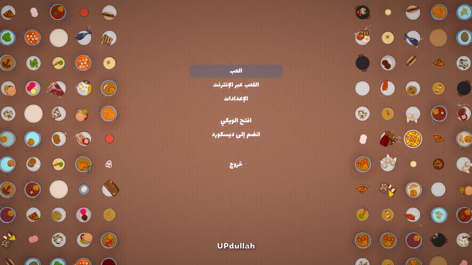
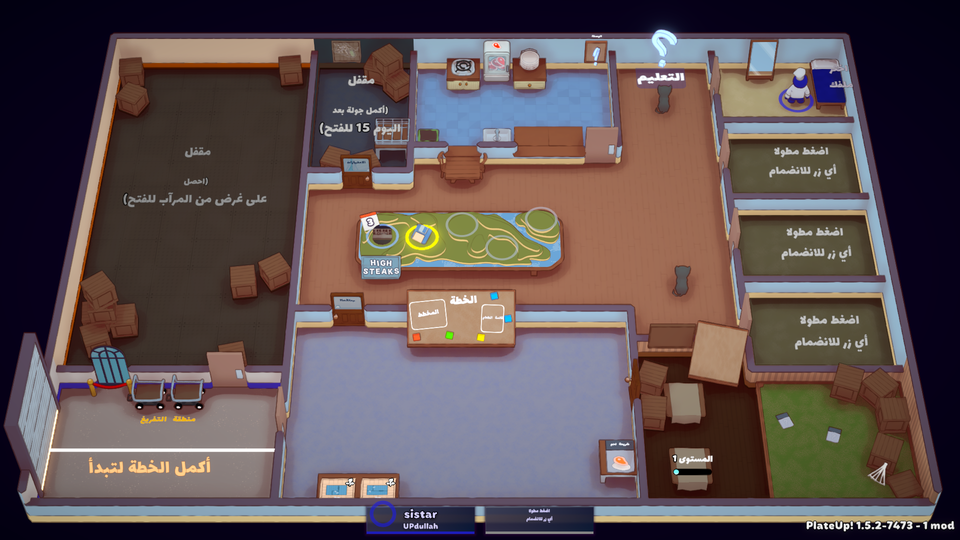

<div dir="rtl">

# ‏PlateUp!‎ بالعربية

تعريب كامل للعبة [‏PlateUp!‎](https://store.steampowered.com/app/1599600/) على هيئة إضافة:
القوائم والأطباق والبطاقات والأجهزة والوصفات والإنجازات — **2,223 نصًّا**.

لا يُعدَّل أي ملف من ملفات اللعبة: كل شيء في مجلد واحد اسمه `Mods/PlateUpArabic`، وحذفه
وحده يُعيد اللعبة إلى الإنجليزية تمامًا كما كانت.

</div>

[](../../releases/latest)
[](LICENSE)
[](#)





<div dir="rtl">

## في سطور

| | |
|---|---|
| **اللعبة المدعومة** | ‏PlateUp!‎ — النسخة **1.5.2** |
| **ما يعرّبه** | القوائم والأطباق والبطاقات والأجهزة والوصفات والإنجازات |
| **ملفات اللعبة** | لا يُمَس منها شيء؛ كل شيء داخل `Mods/PlateUpArabic` |
| **الإزالة** | زر «إزالة» في المثبّت، أو حذف المجلد يدويًا |
| **اللعب الجماعي والإنجازات** | تعمل كالمعتاد |
| **متطلبات إضافية** | لا شيء |

## المتطلبات

| النظام | ما يلزم |
|---|---|
| ويندوز 10 أو 11 | لا شيء غير النظام نفسه (PowerShell مثبَّت مسبقًا) |
| لينكس | `bash`، وأي توزيعة حديثة |
| ستيم ديك | وضع سطح المكتب (Desktop Mode) |
| اللعبة | نسخة Steam من ‏PlateUp!‎ |

## التنزيل

من صفحة **[الإصدارات](../../releases/latest)** نزّل `PlateUpArabic-1.0.0.zip` (نحو 300 ك.ب)،
ثم **فُكّ ضغطه** قبل أي خطوة أخرى.

## التثبيت على ويندوز

1. **أغلق اللعبة** إن كانت مفتوحة.
2. فُكّ ضغط الملف: زر الفأرة الأيمن ← **Extract All…** ← **Extract**.
3. افتح المجلد الناتج، وانقر نقرًا مزدوجًا على `install-windows.bat`.
4. تفتح نافذة صغيرة تعثر على اللعبة وحدها. اضغط **تثبيت**.
5. إن لم يجدها، اضغط **استعراض…** وحدّد المجلد الذي يحتوي على `PlateUp.exe`.

إن ظهرت رسالة عن الصلاحيات، انقر على `install-windows.bat` بزر الفأرة الأيمن واختر
**تشغيل كمسؤول**.

## التثبيت على لينكس

فُكّ الضغط، ثم من داخل المجلد:

</div>

```bash
./install.sh
```

<div dir="rtl">

ولتحديد مسار اللعبة بنفسك:

</div>

```bash
./install.sh "/path/to/PlateUp"
```

<div dir="rtl">

وإن ظهرت رسالة `Permission denied`، فمعنى ذلك أن مدير الملفات لم يحفظ صلاحية التنفيذ:

</div>

```bash
chmod +x install.sh && ./install.sh
```

<div dir="rtl">

## التثبيت على ستيم ديك

1. اضغط **STEAM** ← **Power** ← **Switch to Desktop**.
2. افتح **Konsole** من قائمة التطبيقات.
3. اكتب:

</div>

```bash
cd ~/Downloads/PlateUpArabic-1.0.0
./install.sh
```

<div dir="rtl">

4. سيجد المثبّت اللعبة في مكتبة Steam على الجهاز أو بطاقة الذاكرة. ثم عُد إلى وضع اللعب.

## تشغيل التعريب

شغّل اللعبة ← **الإعدادات** ← اختر **العربية** من قائمة اللغات.

## الإزالة

- ويندوز: شغّل `install-windows.bat` واضغط **إزالة**.
- لينكس: `./install.sh --uninstall`

أو احذف مجلد `Mods/PlateUpArabic` من مجلد اللعبة يدويًا؛ لا يضع المثبّت شيئًا خارجه.

## بعد تحديث اللعبة

إن حُدِّثت اللعبة وبدا نص في غير موضعه أو ظهر بالإنجليزية، فأعد تثبيت أحدث إصدار من التعريب
فوق القديم. وإن اختفت العربية من قائمة اللغات، فتحقّق من ملفات اللعبة في Steam ثم أعد التثبيت.

## إن لم يعمل

| ما تراه | السبب | الحل |
|---|---|---|
| لا تظهر **العربية** في قائمة اللغات | الإضافة في مجلد خطأ | أعد التثبيت وحدّد المجلد الذي فيه `PlateUp.exe` |
| اللعبة لا تبدأ بعد التثبيت | إصدار اللعبة تغيّر | احذف `Mods/PlateUpArabic` ثم حدّث التعريب |
| النص عربي لكن الحروف متلاصقة | الخط لم يُحمّل | أعد التثبيت بمجلد كامل غير ناقص |
| الجولات لا تُسجَّل في قوائم السرعة | سلوك تفرضه اللعبة على كل إضافة | لا حل؛ الإنجازات واللعب الجماعي يعملان |
| ويندوز يمنع تشغيل `.bat` | سياسة PowerShell | انقر بزر الفأرة الأيمن ← **تشغيل كمسؤول** |

## أسئلة سريعة

**هل تؤثر على اللعب الجماعي؟** لا. اللاعبون الآخرون لا يحتاجون التعريب، ولا تتغير غرفتك.

**هل تُلغي الإنجازات؟** لا. الإنجازات تعمل كالمعتاد؛ المتوقف هو تسجيل السرعة فقط.

**هل يلزم تثبيت أي برنامج؟** لا. المثبّت نافذة PowerShell جاهزة في ويندوز.

**هل يمكن التثبيت بلا Steam؟** المثبّت يبحث عن نسخة Steam، لكن يمكنك تمرير أي مجلد يحتوي على
`PlateUp.exe` بنفسك.

## ما ينبغي معرفته

- **الإنجازات واللعب الجماعي تعمل كالمعتاد.** الشيء الوحيد الذي يتوقف هو تسجيل الجولات في
  قوائم السرعة (speedrun leaderboards)، وهذا شرط تفرضه اللعبة على أي إضافة مهما كانت.
- النصوص مكتوبة بلا تشكيل، لأن محرّك النصوص في اللعبة لا يضع الحركات في مواضعها الصحيحة.
- النسخة المدعومة من اللعبة: **1.5.2**.

## للمهتمين تقنيًا

| ما يفعله المثبّت | التفصيل |
|---|---|
| ينسخ | `PlateUpArabic/` (الملف التنفيذي والنصوص والخطوط) إلى `Mods/` |
| لا يعدّل | أي ملف من ملفات اللعبة |
| يتحقق من اللعبة | عبر `appmanifest_1599600.acf` وملفات مكتبات Steam |
| الإزالة | حذف المجلد نفسه، لا أكثر |

شرح آلية العمل وبنية المشروع في [docs/internals.md](docs/internals.md)، ودليل المصطلحات
وقواعد الصياغة في [docs/glossary.md](docs/glossary.md).

## الخطوط والتراخيص

الخطوط المستخدمة [Lalezar](https://github.com/BornaIz/Lalezar) للعناوين
و[Noto Sans Arabic](https://github.com/notofonts/arabic) لبقية النصوص، وكلاهما برخصة
SIL Open Font License 1.1.

شيفرة المشروع برخصة MIT. هذا عمل غير رسمي من المعجبين، ولا صلة له بمطوّري اللعبة.

## الإبلاغ والمساهمة

افتح [مشكلة](../../issues) واذكر النص كما ظهر وأين رأيته في اللعبة، وأرفق صورة إن أمكن.

</div>
